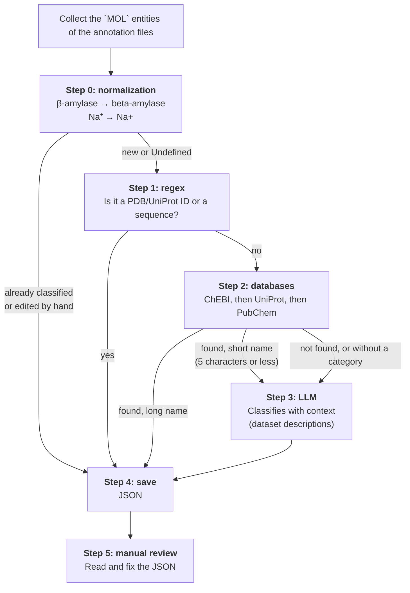
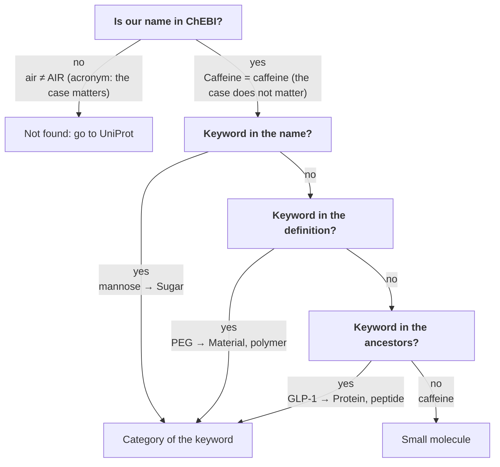
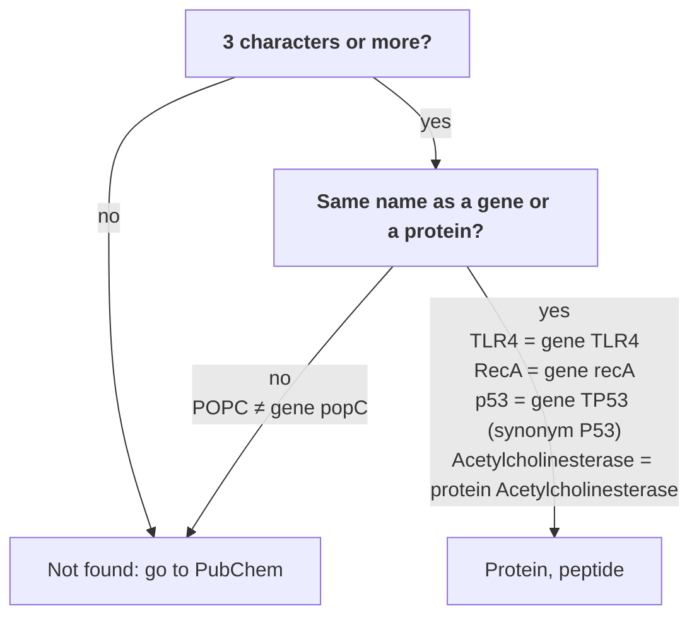
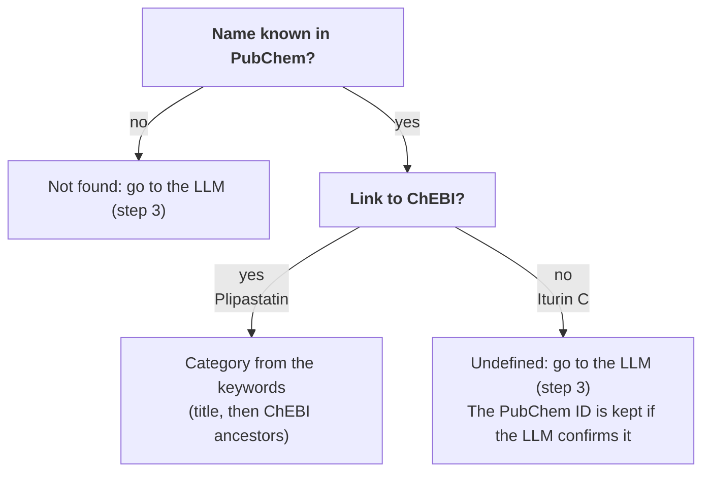

# How molecules are classified?

The script [classify_molecules.py](../src/mdner_llm/annotations/classify_molecules.py) gives one category to each molecule entity (`MOL`) of the annotated datasets. Results are saved in a [JSON database](../data/normalization/molecules.json).

**Categories:** `Protein, peptide`, `Lipid`, `Small molecule`, `Ion`, `Material, polymer`, `PDB ID`, `Sugar`, `Nucleic acid`, `Sequence`, `UniProt ID`, `Undefined`.


Here is the flowchart of the classification process:



## Usage

### Command line

To characterize the molecules in our groundtruth annotations, run:

```bash
uv run classify-molecules \
    --annotations-path data/groundtruth \
    --db data/normalization/molecules.json \
    --llm google/gemma-4-31b-it \
    --prompt-path docs/mol_classification_prompt.md
```

> [!NOTE]
> The LLM is optional. It needs `OPENROUTER_API_KEY` in the `.env` file.
> - Step 3 only runs with `--llm`. Without it, a name that is not found is `Undefined`.
> - With `--llm`, a short name found in a database by an earlier run, but never checked by the LLM, is classified again.

Each molecule is one entry of the JSON database. For example:

```json
[
  {
    "name": "TLR4",
    "category": "Protein, peptide",
    "database_source": "UniProt (checked by LLM (google/gemma-4-31b-it))",
    "database_id": "O00206",
    "database_url": "https://www.uniprot.org/uniprotkb/O00206/entry",
    "curation": "automatic",
    "justification": "",
    "nb_mentions": 18,
    "datasets": {
      "zenodo_18468770.json": "https://zenodo.org/records/18468770",
      ...
    }
  },
  {
    "name": "POPC",
    "category": "Lipid",
    "database_source": "PubChem (checked by LLM (google/gemma-4-31b-it))",
    "database_id": "CID:5497103",
    "database_url": "https://pubchem.ncbi.nlm.nih.gov/compound/5497103",
    "curation": "automatic",
    "justification": "",
    "nb_mentions": 81,
    "datasets": {
      "zenodo_1009607.json": "https://zenodo.org/records/1009607",
      ...
    }
  },
  ...
]
```

`nb_mentions` (number of mentions) and `datasets` (annotation files mentioning the molecule, with their links) are updated at each run. `curation` is `manual` if the molecule was checked by hand.

### Notebook

To characterize the molecules in our groundtruth annotations, the notebook [paper_tables_and_figures.ipynb](../notebooks/paper_tables_and_figures.ipynb) runs the same classification with `classify_mol_entities`. It then summarizes the categories with `summarize_mol_categories`. We obtain this table:

| Category | Mentions | Share of MOL | Unique mentions | Texts | Examples |
|---|---:|---:|---:|---:|---|
| `Protein, peptide` | 544 | 36.1% | 211 | 76 | `TLR4`, `ChAT`, `MD-2` |
| `Lipid` | 318 | 21.1% | 62 | 68 | `POPC`, `DPPC`, `cholesterol` |
| `Small molecule` | 306 | 20.3% | 140 | 56 | `METH`, `DOX`, `n-C28` |
| `Ion` | 141 | 9.3% | 40 | 41 | `NaCl`, `Na+`, `Cl-` |
| `Material, polymer` | 81 | 5.4% | 29 | 15 | `PEG`, `GO`, `graphene` |
| `PDB ID` | 55 | 3.6% | 42 | 21 | `4KSB`, `3G5U`, `4ZUD` |
| `Sugar` | 23 | 1.5% | 10 | 4 | `furanose`, `carbohydrates`, `mannose` |
| `Nucleic acid` | 22 | 1.5% | 10 | 3 | `LNA`, `RNV66`, `V7t1` |
| `Sequence` | 13 | 0.9% | 13 | 7 | `(GVPGV)7`, `5'-CGATTTTTTGGC-3'`, `5'-GCGGCGCGCCGC-3'` |
| `UniProt ID` | 4 | 0.3% | 4 | 4 | `F2Z4Y2`, `P01116-2`, `P12497` |
| `Undefined` | 2 | 0.1% | 1 | 1 | `air` |

`Texts` is the number of datasets with at least one molecule of the category. `Examples` are the most mentioned names.

## How it works

### Step 0: normalization of the `MOL` entities

Molecule names are normalized by the function [`clean_text`](../src/mdner_llm/common.py).

**Why is it important?** The same molecule can be written in several ways. Without normalization, it is counted and classified several times. In our datasets, `TARP γ-7` and `TARP gamma-7` are the same entity.

| What `clean_text` does | Before | After |
|---|---|---|
| Apply NFKC (see below) | `Na⁺`, `RKIRRKFKK-NH₂` | `Na+`, `RKIRRKFKK-NH2` |
| Write Greek letters in full | `β-amylase` | `beta-amylase` |
| Replace special dashes | `sars‑cov‑2` | `sars-cov-2` |
| Replace curly quotes | `5’-GCG-3’` | `5'-GCG-3'` |
| Remove extra spaces | `sodium   chloride ` | `sodium chloride` |


**What is NFKC?** It is a [standard Unicode form](https://apxml.com/courses/how-to-build-a-large-language-model/chapter-7-data-cleaning-preprocessing-pipelines/text-normalization-methods) that replaces different ways to write the same character by a single one:

| What NFKC replaces | Before | After |
|---|---|---|
| Subscripts and superscripts | `O₃`, `Ca²⁺` | `O3`, `Ca2+` |
| Special spaces | `sodium chloride` (non-breaking space) | `sodium chloride` (normal space) |
| Joined letters (ligatures) | `fibrin` (one character for `fi`) | `fibrin` |
| Wide letters | `ＮａＣｌ` | `NaCl` |
| Special symbols and numbers | `Ⅱ`, `…`, `™` | `II`, `...`, `TM` |
| Letter + separate accent | `e` + `´` (2 characters) | `é` (1 character) |
| Twin characters | `µ` (micro sign) | `μ` (Greek letter) |

**Why not put everything in lower case?** Case can change the meaning, mostly for short names. `AIR` is a molecule in ChEBI, but `air` is the gas mixture. In lower case, we could not tell them apart.

So names are grouped (in `group_mol_entities`) with a simple rule:

| Length of the name | Case | Example |
|---|---|---|
| 5 characters or less | Kept | `AIR` and `air` are two entities |
| More than 5 characters | Ignored | `Cholesterol` and `cholesterol` are one entity |

**Which spelling do we keep?** When several spellings are grouped, only one is saved:

1. **The molecule is already in the JSON:** it directly gets the same category, without a new search. Example: if the JSON has `cholesterol` (`Lipid`), then `Cholesterol` is also a `Lipid`.
2. **The molecule is not in the JSON yet:** it is classified and added with its most frequent spelling. Example: `cholesterol` (27 mentions) and `Cholesterol` (2 mentions) are added as `cholesterol`.


**Limits:** some duplicates remain in the JSON.

| Duplicate | Example | Why it is not merged |
|---|---|---|
| Case of short names (5 characters or less) | `Urea` and `urea` | The case can change the meaning (`AIR` and `air`). |
| Singular and plural | `cholesterol` (found in ChEBI) and `cholesterols` (classified by the LLM) | Plurals are not handled. Removing every final "s" is not safe: `H2S` would become `H2`. |

### Step 1: regex

The shape of the name is enough for IDs and sequences.

| Category | ✅ Accepted | ❌ Rejected | Why rejected |
|---|---|---|---|
| `PDB ID` | `6LU7`, `6lu7` | `1000` | Only digits |
| `UniProt ID` | `P01116`, `P01116-2` | `P01116abc` | Not in UniProt |
| `Sequence` (DNA, RNA) | `5'-GCTAAAAAACCG-3'` | `GCTAAAAAACCG` | No `5'-` and `-3'` |
| `Sequence` (peptide) | `RKIRRKFKK-NH2` | `palmitate` | Lower case |
| `Sequence` (motif) | `(GVPGV)7` | `GVPGV` | No repeat number |

**Why also call an API?** A name can have the right shape by chance. The PDB and UniProt IDs must also exist in their database.

**Why are peptides in upper case only?** Many common words use only amino acid letters: `palmitate`, `triglyceride`, `indinavir`.

### Step 2: public databases

The databases are searched in this order, and **the first one that answers wins**.

#### 2a. ChEBI

Chemical Entities of Biological Interest ([ChEBI](https://www.ebi.ac.uk/chebi/)) is an ontology of small molecules, lipids, ions, nucleic acids, and peptides: each molecule is linked to its families by "is a" relations (mannose *is an* aldohexose, which *is a* hexose). Each category has its keywords, written as a regex. They are tested in this order, and the first match wins:

| Category | Regex | Explanation |
|---|---|---|
| `Nucleic acid` | `nucleic acid\|oligonucleotide\|\b[dr]na\b` | Contains "nucleic acid" or "oligonucleotide", or the whole word "dna" or "rna". |
| `Protein, peptide` | `\b(?:protein\|(?:poly\|oligo\|di)?peptide)s?\b(?! (?:\w+ )?inhibitor)\|^[a-z]+ase$` | Contains the whole word "protein" or "peptide" (also "polypeptide", "oligopeptide", "dipeptide", and plurals), not followed by "inhibitor" ("protein kinase inhibitor" is a drug). Or the text is only one word ending in "ase" ("peroxidase"). |
| `Sugar` | `\b(?:mono\|di\|oligo\|poly)saccharides?\b(?! derivative)\|^carbohydrates?$\|^[a-z]+ose$` | Contains "monosaccharide", "disaccharide", "oligosaccharide" or "polysaccharide" (not followed by "derivative"), or the text is only "carbohydrate(s)", or only one word ending in "ose" ("mannose"). |
| `Lipid` | `lipid\|fatty acid\|glycerophospho\|phosphocholine\|steroid\|sterol\|sphingo\|ceramide\|glyceride` | Contains one of these words, even inside a longer word ("sterol" in "cholesterol"). |
| `Material, polymer` | `polymer\|macromolecule\|elemental carbon\|nanotube` | Contains one of these words, even inside a longer word ("polymer" in "copolymer"). |
| `Ion` | `^ion$\|\bsalt$\|alkali metal atom\|alkaline earth metal atom\|^halogen$` | The text is only "ion" or "halogen", ends with the word "salt", or contains "alkali metal atom" or "alkaline earth metal atom". |
| `Small molecule` | | No regex matches. |





**First, is it the right molecule?** Our name must be equal to the label or to a synonym.

The search ignores case, which is useful for `Caffeine` ([CHEBI:27732](https://www.ebi.ac.uk/chebi/CHEBI:27732)) but wrong for acronyms: a search for `air` returns the molecule `AIR` ([CHEBI:138560](https://www.ebi.ac.uk/chebi/CHEBI:138560)). So a ChEBI acronym (5 characters or less, in upper case) must match with the same case.

| Name | ChEBI name | Match |
|---|---|---|
| `Caffeine` | `caffeine` | ✅ |
| `AIR` | `AIR` | ✅ |
| `air` | `AIR` | ❌ |

**Then, which category?** ChEBI does not give our categories. We look for keywords in three texts, and stop at the first match:

| Order | Text | Example | Category |
|---|---|---|---|
| 1 | Name | **mannose** ([CHEBI:37684](https://www.ebi.ac.uk/chebi/CHEBI:37684)), ends in -ose | `Sugar` |
| 2 | Definition | PEG ([CHEBI:46793](https://www.ebi.ac.uk/chebi/CHEBI:46793)): "A **polymer** composed of repeating ethyleneoxy units." | `Material, polymer` |
| 3 | Ancestors | GLP-1 ([CHEBI:749689](https://www.ebi.ac.uk/chebi/CHEBI:749689)): "**polypeptide**", "**peptide**" ([see the tree](https://www.ebi.ac.uk/ols4/ontologies/chebi/classes?obo_id=CHEBI:749689)) | `Protein, peptide` |
| | No keyword | caffeine ([CHEBI:27732](https://www.ebi.ac.uk/chebi/CHEBI:27732)) | `Small molecule` |

Ancestors are the families of a molecule in ChEBI. We get them with the [OLS4 API](https://www.ebi.ac.uk/ols4/help) (Ontology Lookup Service, EMBL-EBI), with the `hierarchicalAncestors` endpoint ([request for GLP-1](https://www.ebi.ac.uk/ols4/api/ontologies/chebi/hierarchicalAncestors?id=CHEBI:749689&size=1000)).

Why these choices?

| Choice | Reason |
|---|---|
| Ancestors come last | They need one more request. The name and the definition are already in the search result. |
| The definition is not enough | Many terms have none (GLP-1), or use other words. The definition of DMPC says "phosphatidylcholine", not "lipid". |
| `Lipid` is tested before `Ion` | DPPC has both a phosphocholine and `ion` in its ancestors. |
| `salt` must be the last word | Nelfinavir is a drug "used (as its mesylate **salt**) for treatment of HIV". It is not an ion. |
| "derivative" is excluded from `Sugar` | ATP is a "monosaccharide derivative" in ChEBI. |
| `-ose` must be a single word | UDP-D-glucose is not a sugar, and definitions contain "those" or "dose". |

#### 2b. UniProt

[UniProt](https://www.uniprot.org/) is a protein database. If our name is a gene or a protein in UniProt (reviewed entries only), its category is `Protein, peptide`.



The genes are searched first, then the proteins, with all their names (synonyms and short names included).

**When are two names the same?** The UniProt search ignores case: for the lipid `POPC`, it returns the bacterial gene `popC` ([Q1DFT5](https://www.uniprot.org/uniprotkb/Q1DFT5)). So we compare the full names ourselves:

| Length of our name | Rule | Why |
|---|---|---|
| 5 characters or less | Only the case of the first letter is ignored | A protein and its gene can differ by this letter (`RecA` and `recA`). The case of the other letters can change the meaning (`POPC` and `popC`). |
| More than 5 characters | The case is ignored | Same rule as in step 0 |

| Our name | Name in UniProt | Same? | Why |
|---|---|---|---|
| `TLR4` | [Gene `TLR4`](https://www.uniprot.org/uniprotkb/O00206/entry) | ✅ | Same case |
| `RecA` | [Gene `recA`](https://www.uniprot.org/uniprotkb/P0A7G6/entry) | ✅ | Only the first letter differs |
| `p53` | [Gene `TP53`, synonym `P53`](https://www.uniprot.org/uniprotkb/P04637/entry) | ✅ | Only the first letter differs from the synonym `P53` |
| `POPC` | [Gene `popC`](https://www.uniprot.org/uniprotkb/Q1DFT5/entry) | ❌ | Other letters differ |
| `acetylcholinesterase` | [Protein "Acetylcholinesterase"](https://www.uniprot.org/uniprotkb/P22303/entry) | ✅ | More than 5 characters |

> [!NOTE]
> A short name can be a gene by chance: `air` is also the name of a bacterial gene. So the LLM checks every short name (step 3). Without `--llm`, these matches are not checked.

#### 2c. PubChem

[PubChem](https://pubchem.ncbi.nlm.nih.gov/) is a database of small molecules, lipids, ions, nucleic acids, and peptides. It has many more names than ChEBI, but no category that we can use. We use its link to ChEBI when there is one.



Example: ChEBI does not know the name `Plipastatin`, but PubChem does.

```text
Plipastatin → PubChem CID 5491283 ("Fengycin C") → CHEBI:218999 → Protein, peptide
```

Without a link to ChEBI, the category is `Undefined` and the LLM chooses it (step 3). The formula and the charge are not enough: `Iturin C` is a neutral molecule but a peptide, and `iperoxo` has a charge but is a drug.

### Step 3: LLM

The LLM reads the [prompt](mol_classification_prompt.md) and the descriptions of the datasets that mention the entity. It handles three cases:

| Case | Example | Result |
|---|---|---|
| Not found in step 2 | `Chignolin` | The LLM gives the category. There is no database ID. |
| Short name found in step 2 | `TLR4` (UniProt) | The LLM says if it is the right molecule. |
| Found in PubChem without a category | `Iturin C` (PubChem) | The LLM gives the category and says if it is the right molecule. |

**Why check short names?** A short name can have several meanings. `AE` is a dipeptide in ChEBI, but it was an enzyme in one of our datasets.

- If the LLM **confirms** the match, the database ID is kept and the source becomes `UniProt (checked by LLM (model name))`. The category is the one given by the LLM.
- If the LLM **rejects** it, the ID is removed and the source becomes `LLM (model name)`.

**What is the format of the answer?** The LLM must follow the Pydantic schema `MoleculeCategory` ([molecule_category.py](../src/mdner_llm/models/molecule_category.py)):

| Field | Type | Meaning |
|---|---|---|
| `justification` | text | One sentence that explains the choice. It is saved in the JSON, for the manual review (empty for molecules classified without the LLM, or before this field existed) |
| `candidate_matches` | true / false | Is the database match the right molecule? |
| `category` | one of our categories | `Undefined` if the LLM is not sure, as for `air` |

The library [Instructor](https://python.useinstructor.com/) checks the answer. If it does not follow the schema (for example, an unknown category), Instructor asks the LLM again, up to 3 times. If it still fails, the error is logged and the molecule keeps its result of step 2 (or `Undefined`).

### Step 4: save

The results are saved in the JSON, even if the script is interrupted.

- **Classified molecules are not searched again.** If you change the rules, the old results stay in the JSON.
- **Molecules are never deleted**, even if they are no longer annotated. They have `nb_mentions = 0` and no `datasets`.

### Step 5: manual review

To find the mistakes, use the `justification`, `nb_mentions` and `datasets` fields of each molecule.

**To fix a category or a database ID by hand**, edit the JSON and set `"curation": "manual"`. The script will never change this molecule again.

## Known mistakes

### Ions written without their charge

In MD simulations, `NaCl` is a salt dissolved in water: the system contains Na⁺ and Cl⁻ ions. Authors often write `Na` or `Cl` without the charge ("2880 SPC waters, 8 Na, 8 Cl"). But in ChEBI, these names are synonyms of the **neutral atom**. The category was right (`Ion`), but not the ID. The LLM did not see it for the short names, and it does not check long names like `sodium` or `potassium`.

The IDs of these 9 names were corrected by hand (`"curation": "manual"`), after reading how the datasets use these names:

| Name | ID found by the script | Corrected ID |
|---|---|---|
| `Na`, `NA`, `sodium` | [CHEBI:26708](https://www.ebi.ac.uk/chebi/CHEBI:26708) (sodium atom) | [CHEBI:29101](https://www.ebi.ac.uk/chebi/CHEBI:29101) (sodium(1+)) |
| `Cl`, `CL` | [CHEBI:23116](https://www.ebi.ac.uk/chebi/CHEBI:23116) (chlorine atom) | [CHEBI:17996](https://www.ebi.ac.uk/chebi/CHEBI:17996) (chloride) |
| `Ca`, `Calcium` | [CHEBI:22984](https://www.ebi.ac.uk/chebi/CHEBI:22984) (calcium atom) | [CHEBI:29108](https://www.ebi.ac.uk/chebi/CHEBI:29108) (calcium(2+)) |
| `MG` | [CHEBI:25107](https://www.ebi.ac.uk/chebi/CHEBI:25107) (magnesium atom) | [CHEBI:18420](https://www.ebi.ac.uk/chebi/CHEBI:18420) (magnesium(2+)) |
| `potassium` | [CHEBI:26216](https://www.ebi.ac.uk/chebi/CHEBI:26216) (potassium atom) | [CHEBI:29103](https://www.ebi.ac.uk/chebi/CHEBI:29103) (potassium(1+)) |

The names `Na+`, `Cl-`, `chloride` and `NaCl` already had the right ID.
